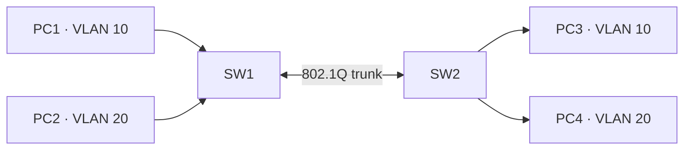
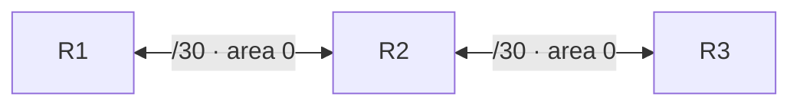

**English** | [Русский](README.ru.md)

# Network Security Lab

An educational network security portfolio project combining **protocol analysis, GNS3 topology design, VLAN hardening, OSPF authentication, and offline packet inspection in Python**.

This repository brings together practical networking and traffic-analysis work. It includes **sanitized network examples**, **redacted case notes**, **original synthetic PCAPs**, and a small **read-only PCAP/PCAPNG inventory tool**. It does **not** contain private source captures, proprietary IOS images, credentials, or internal instructions.

> **Scope:** This is a hands-on networking/security lab, not a penetration-testing framework or a production intrusion detection system. Synthetic captures are clearly labeled and must not be mistaken for evidence of live incidents.

## Skills demonstrated

- reviewing DNS, DHCP, NTP, SSH, SMB and TCP/IP traffic;
- applying Wireshark filters and interpreting flow metadata;
- building and reviewing network layouts in GNS3;
- segmenting Layer 2 networks with VLANs and explicit access/trunk ports;
- documenting hardening measures against common VLAN misconfigurations;
- understanding OSPF adjacencies, path costs and legacy link authentication;
- documenting findings from SMB and suspicious TCP traffic in an isolated lab;
- Python 3 packet-file parsing, offline packet generation, and automated testing;
- optional Scapy-based packet construction **without sending traffic**;
- GitHub Actions CI and publication-safe documentation practices.

## Project structure

```text
network-security-lab/
├── README.md
├── README.ru.md
├── Makefile
├── .gitignore
├── .github/workflows/ci.yml
├── src/
│   ├── pcap_summary.py
│   └── scapy_offline_demo.py
├── scripts/
│   ├── generate_demo_pcaps.py
│   └── audit_publication.py
├── tests/
│   ├── test_pcap_summary.py
│   └── test_topologies.py
├── captures/demo/
│   ├── dns-demo.pcap
│   ├── dhcp-demo.pcap
│   ├── ntp-demo.pcap
│   ├── ssh-demo.pcap
│   ├── ospf-demo.pcap
│   ├── smb-demo.pcap
│   └── tcp-review-demo.pcap
├── configs/
│   ├── vlan-sw1.example.cfg
│   ├── vlan-sw2.example.cfg
│   ├── ospf-r1.example.cfg
│   ├── ospf-r2.example.cfg
│   └── ospf-r3.example.cfg
├── topologies/gns3/
│   ├── README.md
│   ├── vlan-segmentation.gns3
│   └── ospf-chain.gns3
└── docs/
    ├── protocol-analysis.md
    ├── vlan-ospf-hardening.md
    ├── traffic-cases.md
    └── analysis-method.md
```

## Main components

### 1. Protocol analysis — DNS, DHCP, NTP, SSH

A concise protocol-focused investigation covers DNS A/IN queries, the DHCP DORA sequence, NTP time exchange, SSH session metadata, and static routing. Findings are summarized in [protocol-analysis.md](docs/protocol-analysis.md).

The public PCAPs are **newly generated, minimal, synthetic samples**, not the original packet recordings. They illustrate specific headers or port patterns rather than complete application sessions.

### 2. VLAN security and GNS3

Two switches with four PCs demonstrate VLAN 10/20 segmentation. The reviewed hardening measures include explicit access/trunk mode, an unused-port parking VLAN 998, native VLAN 999, and a restricted trunk allowed list.



See [hardening notes](docs/vlan-ospf-hardening.md), [config snippets](configs/vlan-sw1.example.cfg), and [GNS3 topology](topologies/gns3/vlan-segmentation.gns3).

### 3. OSPF routing and authentication

A three-router chain uses OSPF area 0. The lab notes describe validated `FULL` neighbor relationships, routing-path calculations and legacy message-digest authentication on an older router image.



Sample configurations use **placeholder keys** and documentation address ranges. **Legacy OSPF MD5 is shown only as a historical lab mechanism**, not a recommended production default. See [notes](docs/vlan-ospf-hardening.md), [R1 config](configs/ospf-r1.example.cfg), and [GNS3 topology](topologies/gns3/ospf-chain.gns3).

### 4. Traffic analysis case notes

Redacted write-ups summarize two isolated packet-review cases:

- **SMB 3.1.1 / NTLM:** protocol negotiation, authentication sequence and the limits of encrypted SMB3 traffic analysis;
- **Suspicious TCP session:** a manually reviewed interactive command sequence consistent with a reverse-shell-style exchange in a closed lab.

These observations were made from private source recordings and are documented **without redistributing the original recordings, account names, session IDs, MAC addresses, or payloads**. The synthetic public `tcp-review-demo.pcap` contains no reverse shell.

Read [traffic-cases.md](docs/traffic-cases.md).

### 5. Python packet tools

`src/pcap_summary.py` is a dependency-free, **read-only** parser for basic Ethernet/IPv4 PCAP and PCAPNG. It reports protocol hints based on headers and common ports, directional endpoint flows, packet counts and SHA-256 of the capture file. It never prints packet payloads.

`src/scapy_offline_demo.py` is an optional Scapy demonstration that writes a synthetic test packet to disk using `wrpcap`. It does **not** transmit traffic.

**Limitations:** limited Ethernet support; IPv4 focus; basic PCAPNG block types; no TCP reassembly, authentication detection, reverse-shell detection, vulnerability verification, or guaranteed classification from ports.

## Requirements

- Python 3.11 or newer;
- `make` (optional, but convenient);
- Wireshark for examining `.pcap` files (optional);
- GNS3 and **your own lawfully obtained compatible network-device image** to open and run saved topology templates (optional);
- `scapy` only for the optional offline Scapy demo (`pip install scapy`).

The core analyzer and tests use only the Python standard library.

## Running the project

Clone the repository:

```bash
git clone https://github.com/nikamurkaa/network-security-lab.git
cd network-security-lab
```

Generate all safe demonstration captures:

```bash
make demo
# or: python3 scripts/generate_demo_pcaps.py
```

Inspect a DNS capture using the CLI:

```bash
python3 src/pcap_summary.py captures/demo/dns-demo.pcap
```

Get JSON output for scripts or reports:

```bash
python3 src/pcap_summary.py captures/demo/dhcp-demo.pcap --json
```

Generate metadata reports for several examples:

```bash
make summary
```

Optional Scapy packet (writes a local file, sends nothing):

```bash
python3 -m pip install scapy
python3 src/scapy_offline_demo.py
```

Open any demo capture in Wireshark or inspect the Markdown case notes and GNS3 topology templates.

## Tests and CI

```bash
make test   # unittest checks for PCAP/PCAPNG parsing and topology metadata
make check  # tests + syntax compilation + public-file audit
make clean  # remove local build/cache files
```

GitHub Actions runs the offline checks on Python 3.11 and 3.12. The publication audit checks for some internal naming patterns, secret markers and forbidden file extensions; it is **not** a substitute for a human rights/privacy review.

## Project status

Completed portfolio adaptation of networking and traffic-analysis exercises. The original lab observations and manually reviewed topology notes are accompanied by additional documentation, synthetic test data, a Python metadata analyzer and regression tests created for this public version.

No proprietary operating-system images, device runtime files, credentials, original private captures, or internal instruction documents are included.

## Author

[Nicole Zhurbenko](https://github.com/nikamurkaa)
