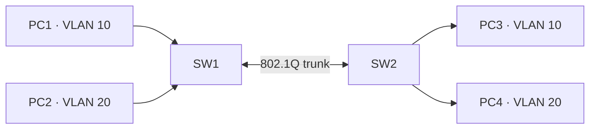
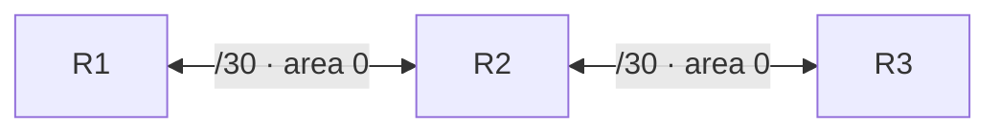

[English](README.md) | **Русский**

# Network Security Lab

Учебный проект по сетевой безопасности: **анализ сетевых протоколов и трафика, топологии GNS3, защита VLAN, аутентификация OSPF и офлайн-анализ PCAP на Python**.

В репозитории собраны результаты практической работы с компьютерными сетями и сетевыми дампами. Публичная версия содержит **обезличенные примеры конфигураций**, **описания результатов исследований**, **синтетические PCAP** и **инструмент анализа метаданных PCAP/PCAPNG**. Закрытые исходные дампы, образы IOS, учётные данные и внутренние инструкции не публикуются.

> **Область применения:** учебная лаборатория, а не инструмент для пентеста или промышленная система обнаружения вторжений. Синтетические пакеты — демонстрационные, они не являются записью реального инцидента.

## Что демонстрирует проект

- анализ DNS, DHCP, NTP, SSH, SMB и TCP/IP;
- применение фильтров Wireshark и исследование сетевых потоков;
- построение и анализ топологий в GNS3;
- сегментация сети через VLAN, настройка access/trunk-портов;
- разбор ошибок конфигурации VLAN и мер усиления защиты;
- понимание OSPF, соседства маршрутизаторов, стоимости пути и аутентификации;
- документирование результатов анализа SMB и подозрительного TCP-соединения;
- Python 3: разбор пакетов из файла, создание офлайн-демонстраций и автотесты;
- Scapy для формирования пакетов **без отправки в сеть**;
- GitHub Actions CI и внимательная подготовка материалов для публикации.

## Структура проекта

```text
network-security-lab/
├── README.md
├── README.ru.md
├── Makefile
├── .gitignore
├── .github/workflows/ci.yml
├── src/
│   ├── pcap_summary.py
│   └── scapy_offline_demo.py
├── scripts/
│   ├── generate_demo_pcaps.py
│   └── audit_publication.py
├── tests/
│   ├── test_pcap_summary.py
│   └── test_topologies.py
├── captures/demo/
│   ├── dns-demo.pcap
│   ├── dhcp-demo.pcap
│   ├── ntp-demo.pcap
│   ├── ssh-demo.pcap
│   ├── ospf-demo.pcap
│   ├── smb-demo.pcap
│   └── tcp-review-demo.pcap
├── configs/
│   ├── vlan-sw1.example.cfg
│   ├── vlan-sw2.example.cfg
│   ├── ospf-r1.example.cfg
│   ├── ospf-r2.example.cfg
│   └── ospf-r3.example.cfg
├── topologies/gns3/
│   ├── README.md
│   ├── vlan-segmentation.gns3
│   └── ospf-chain.gns3
└── docs/
    ├── protocol-analysis.md
    ├── vlan-ospf-hardening.md
    ├── traffic-cases.md
    └── analysis-method.md
```

## Основные части

### 1. Сетевые протоколы: DNS, DHCP, NTP, SSH

Исследуются DNS-запросы A/IN, последовательность DHCP DORA, обмен NTP, метаданные SSH-соединения и статическая маршрутизация. Подробности — в [обзоре протоколов](docs/protocol-analysis.md).

Публичные файлы PCAP **сгенерированы заново** и не являются исходными записями. Каждый файл иллюстрирует отдельный протокол или набор заголовков, а не полноценный сетевой сеанс.

### 2. VLAN и безопасность GNS3-топологии

Два коммутатора и четыре хоста демонстрируют сегментацию на VLAN 10 и 20. В проекте рассмотрены: фиксированный режим access/trunk, парковочная VLAN 998 и отключение неиспользуемых портов, отдельная native VLAN 999, ограниченный список VLAN на trunk.



См. [разбор защиты](docs/vlan-ospf-hardening.md), [конфигурации](configs/vlan-sw1.example.cfg) и [топологию GNS3](topologies/gns3/vlan-segmentation.gns3).

### 3. OSPF и аутентификация маршрутов

Схема из трёх маршрутизаторов в area 0. В заметках описаны проверка состояний соседства `FULL`, расчёт стоимости маршрута и настройка аутентификации на старой версии IOS.



В конфигурациях приведены **только демонстрационные заглушки секретов** и тестовые адреса. **MD5 для OSPF показан как механизм старой учебной платформы, а не рекомендация для современных рабочих сетей.** См. [заметки](docs/vlan-ospf-hardening.md), [пример R1](configs/ospf-r1.example.cfg), [топологию](topologies/gns3/ospf-chain.gns3).

### 4. Кейсы анализа сетевого трафика

В [отчётах](docs/traffic-cases.md) кратко изложены два исследования из изолированной среды:

- **SMB 3.1.1 / NTLM:** согласование протокола, аутентификация, ограничения анализа зашифрованных данных;
- **подозрительная TCP-сессия:** исследование интерактивного обмена с командами, характерного для reverse shell в рамках закрытой лаборатории.

Исходные приватные дампы не публикуются. Файл `tcp-review-demo.pcap` содержит только синтетические TCP-пакеты **без reverse shell**.

### 5. Python-инструменты

`src/pcap_summary.py` — инструмент **чтения файлов без сетевой активности**. Выводит количество пакетов, подсказки по протоколам на основе заголовков и портов, направления TCP/UDP-потоков и SHA-256 файла. Содержимое полезной нагрузки не выводится.

`src/scapy_offline_demo.py` — пример создания и сохранения синтетического пакета через Scapy (`wrpcap`), **без отправки в сеть**.

Ограничения: Ethernet/IPv4, базовые блоки PCAPNG, без TCP reassembly, полноценного декодирования протоколов, обнаружения взлома, анализа эксплуатации уязвимостей или определения вредоносности по одному порту.

## Требования

- Python 3.11+;
- `make` (необязательно);
- Wireshark для визуального анализа дампов (необязательно);
- GNS3 и собственный **легально полученный совместимый образ сетевого устройства** для запуска топологий (необязательно);
- Scapy только для дополнительного примера (`pip install scapy`).

Основной анализатор и тесты работают на стандартной библиотеке Python.

## Запуск

Клонируй репозиторий:

```bash
git clone https://github.com/nikamurkaa/network-security-lab.git
cd network-security-lab
```

Сгенерировать безопасные демонстрационные PCAP:

```bash
make demo
# или: python3 scripts/generate_demo_pcaps.py
```

Вывести информацию о DNS-захвате:

```bash
python3 src/pcap_summary.py captures/demo/dns-demo.pcap
```

Получить JSON-результат:

```bash
python3 src/pcap_summary.py captures/demo/dhcp-demo.pcap --json
```

Показать сводки нескольких захватов:

```bash
make summary
```

Дополнительный пример Scapy (создаёт файл, **ничего не отправляет**):

```bash
python3 -m pip install scapy
python3 src/scapy_offline_demo.py
```

Демонстрационные PCAP можно открыть в Wireshark; для изучения результатов анализа доступны Markdown-отчёты и шаблоны GNS3.

## Тестирование и CI

```bash
make test   # модульные тесты разбора PCAP/PCAPNG и GNS3
make check  # тесты + компиляция Python + аудит публичных материалов
make clean  # удалить временные файлы
```

GitHub Actions проверяет проект на Python 3.11 и 3.12. Автоматический аудит только ищет отдельные нежелательные имена, типы файлов и характерные маркеры секретов. Перед публикацией по-прежнему необходима самостоятельная проверка прав и конфиденциальности.

## Статус проекта

Подготовленная для портфолио версия завершённых сетевых лабораторий. Результаты практических исследований и заметки по настройке дополнены документацией, синтетическими тестовыми данными, собственным Python-анализатором метаданных и регрессионными тестами.

В репозитории отсутствуют проприетарные системные образы, рабочие файлы эмулятора, учётные данные, исходные приватные PCAP и закрытые инструкции.

## Автор

[Nicole Zhurbenko](https://github.com/nikamurkaa)
