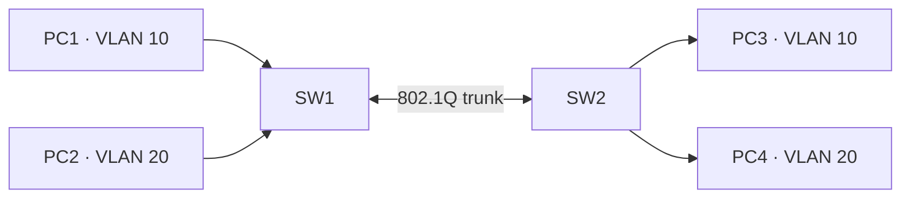
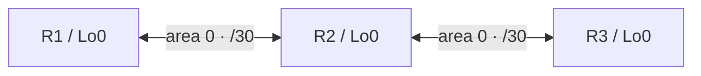

# VLAN segmentation and OSPF authentication notes

## VLAN topology and controls

Two switches connect four hosts. PC1/PC3 belong to VLAN 10; PC2/PC4 belong to VLAN 20. The inter-switch link carries both VLANs through a trunk.



The lab configuration was reviewed with these measures:

- explicit access mode for user ports;
- explicit trunk mode for the inter-switch port;
- native VLAN 999 instead of default VLAN 1;
- restricting allowed VLANs on the trunk;
- unused ports assigned to a separate parking VLAN 998 and administratively shut down;
- verification of same-VLAN connectivity after the changes.

The original lab used older Cisco router hardware with an EtherSwitch module. Some commands available on modern Catalyst switches, such as `switchport nonegotiate`, were not supported by that platform. Commands must be validated against the specific OS and interface implementation.

**Security note:** These configurations are hardening exercises, not a proof that VLAN hopping or other Layer 2 attacks are impossible. Also consider management-plane security and authorized access controls.

Sanitized **illustrative snippets**: [`SW1`](../configs/vlan-sw1.example.cfg) and [`SW2`](../configs/vlan-sw2.example.cfg). They are **not complete device configurations** and do not include original operational details.

## OSPF topology and authentication

Three routers form a chain: R1 — R2 — R3, in area 0, with `/30` point-to-point transit subnets and `/32` loopbacks.



The observed lab validation reported:

- both neighbor relationships reached `FULL`;
- OSPF-installed route costs matched the calculated path costs;
- enabling legacy message-digest authentication did not break established adjacencies;
- connectivity tests to remote loopbacks succeeded after configuration changes.

On the old IOS version used in the lab, message-digest authentication was configured at area level and by per-link keys at interfaces. The example files use **placeholder secrets only**, with distinct placeholders for different links.

**Do not treat OSPF MD5 as a modern production recommendation.** It is documented because the older lab platform supported it. When supported, use stronger authentication and contemporary hardening practices, including appropriate key management and control-plane filtering.

Illustrative sample configurations: [`R1`](../configs/ospf-r1.example.cfg), [`R2`](../configs/ospf-r2.example.cfg), [`R3`](../configs/ospf-r3.example.cfg).

## Recommended verification in a lab

```text
show interfaces trunk
show vlan-switch brief
show ip ospf neighbor
show ip route ospf
show ip ospf interface
```

Command availability differs by device and software version. The example GNS3 projects require user-provided compatible router images and configuration before they can be used for verification.
